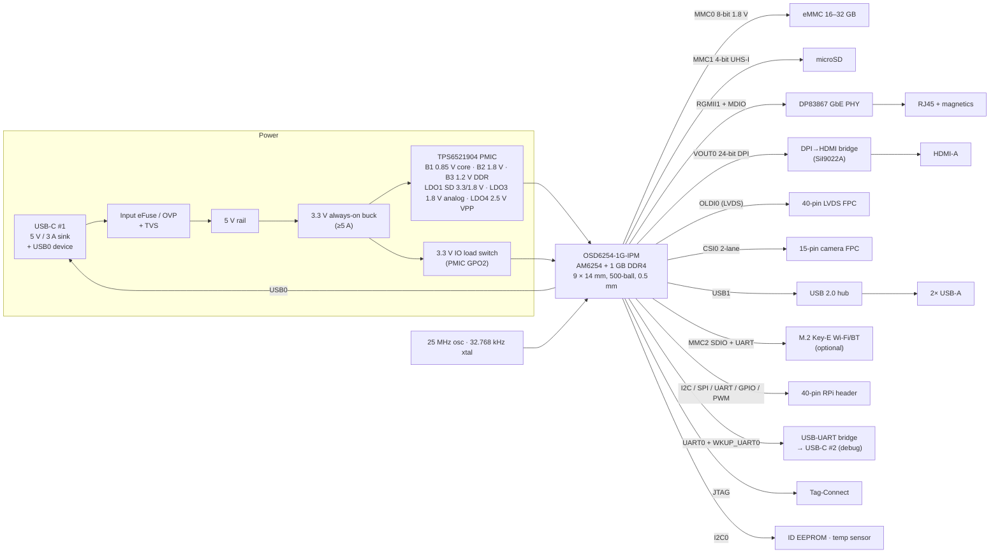
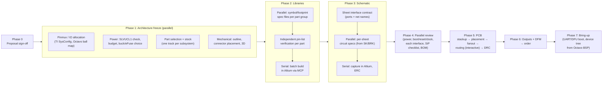

# APE-SBC: Design Proposal

**Single-board computer based on the Octavo OSD6254 (TI AM6254 + 1 GB DDR4 SiP)**

| | |
|---|---|
| Status | **Proposal, for review.** No design work has started. |
| Date | 2026-10-17 |
| EDA | Altium Designer 26, driven partly through the Altium MCP server |
| Inputs | `datasheets/` (AM625 DS, AM62x TRM, TPS65219 DS, OSD62x-PM overview), `reference/` (TI SK-AM62B-P1 rev PROC142B/142A), plus the public OSD62x-PM datasheet Rev 2.0 and Octavo app notes |
| Research notes | [`docs/research/`](docs/research/): page-referenced notes behind every claim below |

---

## 1. Summary

I propose a **credit-card-size (85 × 56 mm) Linux SBC** with a Raspberry-Pi-compatible 40-pin header, built around the **OSD6254-1G-IPM** SiP. The power, boot and peripheral design reuses circuits from TI's **SK-AM62B-P1**, whose schematic, PMIC configuration and DDR4 technology match this part. Octavo's **OSD62-PM-BRK** is the secondary reference for the SiP-specific parts.

The SiP removes the hardest part of an AM62x board: the DDR4 interface. Everything else in the TI reference still applies: the PMIC, power sequencing, clocks, boot straps and all the peripherals. The SK-AM62B needs 10 layers mostly because of DDR4 and its 0.5 mm SoC. Without DDR4, I expect this board to fit on **6 layers with through-vias only** (Octavo's own breakout board uses 4).

### Proposed headline spec

| Item | Proposal |
|---|---|
| Processor | OSD6254-1G-IPM: AM6254, 4× Cortex-A53 @ **1.4 GHz**, Cortex-M4F, 3D GPU, PRU-SS, **1 GB DDR4** inside, -40 to 85 °C case |
| Storage | 8-bit eMMC (16–32 GB, HS200) + microSD (UHS-I) |
| Networking | 1× Gigabit Ethernet (DP83867 + RJ45 with magnetics). *Option:* Wi-Fi 6 / BLE via M.2 Key-E (TI M.2-CC3351) |
| Display | HDMI (up to 1080p60) through a parallel-RGB→HDMI bridge, plus a 40-pin LVDS (OLDI) FPC compatible with TI's SK-LCD1 panel |
| Camera | MIPI CSI-2, 15-pin Raspberry-Pi camera FPC (2 lanes) |
| USB | 2× USB-A host (USB 2.0 hub on USB1), USB-C for power plus USB0 device mode (gadget and DFU boot) |
| Expansion | 40-pin Raspberry-Pi-compatible header (GPIO, I2C, SPI, UART, PWM) |
| Debug | USB-C debug port with an on-board USB-UART bridge, Tag-Connect JTAG footprint, boot-mode DIP switch |
| Power | 5 V / 3 A over USB-C. TPS65219 PMIC with the **TPS6521904** NVM, the same OPN as the SK-AM62B-P1 |
| PCB | 85 × 56 mm, Raspberry Pi B-style mounting holes and header position, **6 layers**, 1.6 mm, through-vias only |

---

## 2. Assumptions (please correct any that are wrong)

1. This is a general-purpose Linux SBC, not a module for a specific product. It should be hand-debuggable and boot from SD or eMMC.
2. The first spin is a prototype (about 5–10 boards) built by a turnkey PCB and assembly house. Cost matters, but first-pass success matters more.
3. Software is TI Processor SDK Linux, starting from Octavo's OSD62-PM-BRK BSP. Mainline Linux is not a v1 goal.
4. Commercial use is fine. The only orderable SiP grade is industrial (-IPM), so we get the wider temperature range at no extra cost.
5. "Parallelize when appropriate" applies to the design process (§9) as well as to this research. All three research tracks for this proposal ran in parallel.

---

## 3. Why OSD6254 + SK-AM62B is a good match

| Topic | Finding | Source |
|---|---|---|
| Memory technology | The SK-AM62B-P1 uses **DDR4** (MT40A1G16TB), the same technology as the SiP. Its PMIC NVM and DDR rails carry over directly. | [SK notes §1](docs/research/sk-am62b-reference-design.md) |
| What the SiP absorbs | All DDR0 routing, VTT/VREF, DDR decoupling, ZQ, CAP_VDDSx caps (1 µF each), USB0/1 and CSI 499 Ω calibration resistors | OSD62x-PM DS Rev 2.0, Tables 4-1/4-2 ([SiP notes §1.3](docs/research/osd62x-pm-sip.md)) |
| What the board must still supply | VDD_CORE / VDDR_CORE, **VDDS_DDR 1.2 V**, **DDR_VPP 2.5 V**, 1.8 V analog, 3.3 V USB, all VDDSHVx IO rails, 25 MHz clock, PMIC, reset, boot straps, every peripheral | [SiP notes §1.4](docs/research/osd62x-pm-sip.md) |
| External decoupling | Small. About 11 µF on VDD_CORE, 0.3 µF on VDDS_DDR, and about 1–5 µF per analog rail. No caps are required under the BGA. | OSD62x-PM DS Table 4-3 |
| Layout | Octavo's reference is **4-layer, through-via only**: 3/3 mil trace and space, 10 mil via pad (6 or 4 mil drill), one via between balls, 0.20 mm NSMD land. No HDI. | Octavo Layout Guide |
| Price / stock (2026-10-17) | Digi-Key: Active, 182 in stock, **$45.48 at qty 1**, 18-week lead time | [SiP notes §3](docs/research/osd62x-pm-sip.md) |

---

## 4. Block diagram



---

## 5. Subsystem proposals

Each block names its reference circuit so the schematic work is mostly reuse plus adaptation. **Bold** marks a choice I'd like you to confirm (also listed in §11).

### 5.1 Power

**Input.** USB-C sink, **5 V only**. Two 5.1 kΩ Rd resistors on CC, so no PD controller is needed (the same approach as the Raspberry Pi 4 and Octavo's BRK). The input stage is an eFuse with over-voltage and reverse-current protection (TPS25947 class), plus a TVS on VBUS. This replaces the SK's TPS65988 dual-port PD controller, its buck-boost and its 15 V input path. VMON_VSYS gets a 5 V divider for early power-fail detection (AM625 DS §8.2.4 worked example).

**Rails:**

| Rail | Source | Loads | Notes |
|---|---|---|---|
| `VCC_5V0` | USB-C via eFuse | USB-A VBUS (2× TPS2051-class 0.5 A switches), HDMI 5 V, header 5 V | Total USB-A budget 1 A |
| `VCC_3V3_MAIN` (always on) | 2.7–5.5 V-input sync buck, **≥ 5 A** (part chosen in Phase 1) | PMIC VSYS and all PVINs, IO load switch | The SK's LM61460 needs at least 4.5 V input, which is marginal on USB 5 V after cable and eFuse drop. Octavo's BRK uses a TLV62595 for a much lighter load (no PHY, hub, HDMI or Wi-Fi). |
| `VDD_CORE` 0.85 V | PMIC **Buck1** | VDD_CORE, **VDDR_CORE (same source)**, VDDA_CORE_USB/CSI, VDD_CANUART | 0.85 V at power-up is required for 1.4 GHz. The AM62x has no DVS. |
| `VDD_1V8` | PMIC Buck2 | VDDSHV4 (eMMC), VDDSHV6 (SDIO), eMMC VCCQ, PHY 1.0 V LDO input, M.2 1.8 V | |
| `VDDS_DDR_1V2` | PMIC Buck3 | SiP VDDS_DDR (SoC DDR IO + DDR4 VDD/VDDQ, merged in the SiP), HDMI bridge 1.2 V | 600–800 mA max for the SiP |
| `VDDSHV5_SD` 3.3/1.8 V | PMIC LDO1 (VSEL_SD from a SoC GPIO) | SoC VDDSHV5 + SD pull-ups | Dual load switch so the SD IO supply and card power cycle together (SK rev-B fix) |
| `VDDA_1V8` | PMIC LDO3 (slow-ramp) | All 1.8 V analog rails, VDDS_OSC0, VMON_1P8 | Ferrite beads per SK p.17 |
| `DDR4_VPP_2V5` | PMIC LDO4 (slow-ramp) | SiP DDR_VPP (60 mA), PHY 2.5 V analog | |
| `VCC_3V3_SYS` | TPS22965 load switch, enabled by **PMIC GPO2**, CT cap sets the slew | VDDSHV0/2/3, VDDSHV_MCU/CANUART, VDDA_3P3_USB, all 3.3 V peripherals | Same scheme as both the SK and the BRK |
| `VDD_1V0_PHY` | TLV75510 | DP83867 core | Use the SOT-23 package (SK D-note: the QFN has assembly issues) |
| `VPP_EFUSE_1V8` | TLV75518, GPIO-enabled, **DNP by default** | SoC VPP (eFuse) | **Not** the DDR4 VPP. Never tie 1.8 V permanently to this pin. |

**PMIC choice: TPS6521904.** It is the only AM62x factory NVM that is DDR4, starts at a 0.85 V core, and accepts a 3.3 V VSYS (TPS6521907 is the 5 V-only equivalent). It ships on the SK-AM62B-P1 and is on Octavo's approved list. Octavo's BRK uses TPS6521903 (0.75 V core, 1.25 GHz) and raises VDD_CORE in software afterwards, which conflicts with TI's guidance that the core voltage is fixed after reset. If you would rather copy the BRK exactly and accept 1.25 GHz, TPS6521903 also works. The rail map above is taken from the SK schematic; I'll confirm it against TI's per-OPN NVM document SLVUCL1 in Phase 1.

**Sequencing.** The order is handled by the PMIC: 3.3 V IO → 1.8 V → (SD IO, DDR VPP) → 1.2 V DDR → 0.85 V core. MCU_PORz is released at least 9.5 ms after the rails are valid. All rails ramp slower than 18 mV/µs, and all must fall below 300 mV before a restart. The SK measured MCU_PORz release at 28.45 ms.

**Coarse power budget (estimate, to be refined in Phase 1):**

| Load | Typical | Worst case |
|---|---|---|
| SiP (SoC + DDR4) | 1.5–2.3 W (Octavo bench: Linux idle / stress-ng) | ~4 W |
| GbE PHY, HDMI bridge, USB hub, eMMC, SD | ~1.5 W | ~2.5 W |
| Camera + LVDS panel logic | — | ~1.8 W |
| M.2 Wi-Fi (if fitted) | ~0.5 W | ~3 W |
| USB-A ports (2× 0.5 A) | — | 5 W |
| 40-pin header (5 V + 3.3 V) | — | ~2 W |
| **Total, including about 12 % conversion loss** | **~4–6 W** | **~20 W** (not simultaneous in practice) |

A 15 W (5 V / 3 A) supply covers realistic use. Limiting USB-A to 1 A total, as on the Raspberry Pi, keeps worst-case peripheral loads inside that budget. If you want guaranteed headroom, a USB-PD sink (9 V) is a later option.

### 5.2 Clocks, reset, boot

- **Clocks:**
  - SoC: 25 MHz LVCMOS oscillator powered from VDDS_OSC0 (1.8 V), with XO tied to VSS. It must be ±50 ppm because of RGMII. This matches the SK (LMK6C-type) and the BRK.
  - PHY: a separate 25 MHz crystal (DP83867 XI is limited to 1.8 V).
  - 32.768 kHz crystal on WKUP_LFOSC0 (RTC, and the slow clock for the Wi-Fi module through WKUP_CLKOUT0).
- **Reset:**
  - PMIC nRSTOUT drives MCU_PORz through a fast logic buffer with a 22 pF glitch filter (SK D-note: do not drive it from a slow open-drain power-good).
  - The reset button feeds RESET_REQz through a Schmitt-trigger debounce.
  - Peripheral resets are AND(RESETSTATz, GPIO).
  - MCU_RESETSTATz must not be used as a reset source (erratum i2407).
- **Power button:** PMIC EN/PB in push-button mode, as on the SK. Whether the board powers up on plug-in comes from the NVM first-supply-detect setting; I'll verify it in SLVUCL1.
- **Boot straps:** all 16 BOOTMODE balls get resistors; none may float. 25 MHz select = `011`.
  - **Important:** BOOTMODE[15:8] share balls with **VOUT0_DATA16–23**. I confirmed this in the AM625 DS pin table: GPMC0_AD8, mode 1, is VOUT0_DATA16. Those bits must therefore be **fixed 10 kΩ straps**, because a DIP switch would load the HDMI data lines. The SK solves this with SN74AVC8T245 isolation buffers, which I propose to drop.
  - A small DIP switch on BOOTMODE[6:3] selects the primary boot device. Those balls (GPMC0_AD3–6) carry no display function, so a switch there is safe.
  - Proposed defaults: **primary = SD card (MMC1, FAT)**, **backup = USB0 DFU**. The switch can select eMMC boot partition, UART, or Ethernet.
  - The ROM needs MMC1_SDCD low, and the PHY and flash powered and out of reset at POR.

### 5.3 Storage

- **eMMC:** 8-bit on MMC0, VDDSHV4 = 1.8 V for HS200. 153-ball JEDEC footprint so several vendors fit. RST_n wired, and the RST_n function must be enabled in EXT_CSD. **16 or 32 GB.**
- **microSD:** MMC1 4-bit with UHS-I (LDO1 3.3/1.8 V switching plus a dual load switch). 47 kΩ pull-ups go to the *switched* IO rail; SDCD gets a 100 Ω series resistor. ESD is a TPD6E001-class array.
- **OSPI NOR: not fitted.** It is not needed for SD or eMMC boot and frees VDDSHV1 balls.

### 5.4 Ethernet

- **1× DP83867IR** on RGMII1, with VDDSHV2 at 3.3 V. This copies SK sheets p.24–26: 3-supply configuration, 22 Ω series resistors on TX at the SoC, RX series option at the PHY, strap set for RGMII-ID.
  - The AM62x always adds the TX delay internally, so the PHY provides the RX delay.
- RJ45 with integrated magnetics and LEDs.
- A second port is possible (CPSW3G has two), but it costs board area. **I recommend one.**

### 5.5 Display and camera

- **HDMI:** **SiI9022A** (the SK part; TI SDK device-tree support exists), fed from VOUT0 24-bit DPI, with a TPD12S016 companion for DDC/HPD level shift, ESD and 5 V current limit. HDMI audio uses McASP.
  - The SiI9022A is an old Lattice part. I'll check stock and lifecycle in Phase 1.
  - The fallback is the **ITE IT66121**, which BeaglePlay uses with an AM625 and which has a mainline Linux driver.
- **LVDS:** 40-pin 0.5 mm FPC, pin-compatible with the SK and BRK connector, so the TI SK-LCD1 panel and the existing device-tree overlays work. It costs a connector and a few passives.
- **Camera:** 15-pin 1.0 mm FPC in Raspberry Pi camera pinout, CSI0 lanes 0–1 + clock. Both the SK and the BRK use this. The camera I2C goes through a TCA9543A-style switch, or a dedicated bus.

### 5.6 USB

- **USB0 → the power USB-C (device only).** Used for USB gadget mode (RNDIS/ACM) and **DFU boot**. VBUS reaches USB0_VBUS through the datasheet divider and clamp. ESD122 protection on D+/D−.
  - DRP/host on this port would mean sourcing VBUS on the power input, so I'm leaving it out.
- **USB1 → USB 2.0 hub → 2× USB-A**, with per-port power switches and TPD4S012-class ESD. Hub candidates are TI TUSB4041I or Microchip USB2422/USB2514B; I'll pick one in Phase 1.
- The datasheet requires no series components on DP/DM other than a common-mode choke with a 0 Ω bypass option. Route at 90 Ω differential.

### 5.7 40-pin expansion header

- **Raspberry-Pi pinout:** I2C, SPI ×2, UART, PWM and GPIO, all at 3.3 V. Pin assignments will be made in TI SysConfig.
- **Differences from the SK:**
  - **Pin 39 = GND.** The SK uses it for HAT-detect.
  - **Pins 27/28 (HAT ID EEPROM) go on their own I2C bus, not the PMIC bus.** The SK shares SoC I2C0 with the PMIC, so a faulty HAT could hang the PMIC bus.
- **Protection:**
  - Most AM62x IOs are **not fail-safe**, so a HAT that drives pins while the board is off can back-power the SoC.
  - Mitigation: 33–100 Ω series resistors on header IO, with header 3.3 V and 5 V supplied from rails that are off when the SoC is off.

### 5.8 Wireless (optional)

**M.2 2230 Key-E socket** on the bottom side, for TI's M.2-CC3351 (Wi-Fi 6 + Bluetooth LE). The interfaces are SDIO on MMC2 (VDDSHV6 at 1.8 V), BT on UART1, and the 32 kHz slow clock. This copies SK p.19, including the rev-B WLAN_IRQ pull-up fix. The module plugs in, so boards without Wi-Fi only carry the socket. **Include it or defer it?**

### 5.9 Debug, ID, misc

- **Debug USB-C #2:**
  - Recommended: a dual USB-UART bridge (CP2105 class) for MAIN_UART0 (U-Boot/Linux console) and WKUP_UART0 (DM firmware). The other consoles go to test pads.
  - Alternative: the SK's FT4232H, which exposes all four consoles but takes more area and cost.
- **JTAG:** Tag-Connect footprint, which is zero BOM cost (Octavo BRK practice); a cable adapter connects it to TI's XDS110 (cTI-20). Add ESD, and pull TRSTn low.
- **Misc:**
  - Board-ID EEPROM on I2C0 (AT24C-class).
  - TMP102-class temperature sensor near the SiP.
  - LEDs: power, heartbeat, 2× user.
  - Buttons: power, reset, user.
- **Dropped from the SK:** XDS110, test-automation connector and buffers, INA231 current monitors, MCU and PRU headers, DANTE parts, I2C LED driver, GPIO expanders (signals move to SoC GPIOs where possible).

---

## 6. IO-voltage plan

| Domain | Voltage | Interfaces |
|---|---|---|
| VDDSHV0 | 3.3 V | UART0, I2C0/1, SPI0, McASP0, MCAN0, SD CD/WP, DRVVBUS, resets |
| VDDSHV1 | 1.8 V | OSPI0 (unused; balls available for 1.8 V GPIO) |
| VDDSHV2 | 3.3 V | RGMII1, MDIO |
| VDDSHV3 | 3.3 V | GPMC0/BOOTMODE straps, VOUT0 DPI → HDMI bridge |
| VDDSHV4 | 1.8 V | MMC0 eMMC (HS200) |
| VDDSHV5 | 3.3 ↔ 1.8 V (switched) | MMC1 microSD (UHS-I) |
| VDDSHV6 | 1.8 V | MMC2 SDIO (M.2 Wi-Fi) |
| VDDSHV_MCU / _CANUART | 3.3 V | MCU/WKUP UART, I2C, JTAG, PMIC_LPM_EN0 |

Net-name rule: the AM62x **VPP** ball is the 1.8 V eFuse pin, and DDR4 VPP is a separate 2.5 V rail. They will be named `VPP_EFUSE_1V8` and `DDR4_VPP_2V5` so they can never be merged by accident.

---

## 7. PCB proposal

| Parameter | Proposal | Rationale |
|---|---|---|
| Size / mechanics | 85 × 56 mm, Raspberry Pi B-style M2.5 hole pattern (58 × 49 mm) and 40-pin header position | HAT and standoff compatibility. Connector positions will differ from a Pi, so Pi cases won't fit as-is. |
| Layers | **6**, 1.6 mm, FR-4 Tg ≥ 170. TOP (sig) / GND / SIG / PWR / GND / BOT (sig) | The SiP fans out on 4 layers (Octavo BRK). With RGMII, USB, HDMI TMDS, CSI and OLDI on an 85 × 56 mm board, 6 layers give every high-speed route a solid reference. 4 layers is a fallback if cost dominates. |
| BGA escape | Octavo pattern: one through-via between balls. **0.15 mm drill / 0.25 mm pad**, 3/3 mil trace and space under the SiP only. 0.20 mm NSMD land. | Octavo's 4 mil-drill option is beyond most fabs at 1.6 mm (16:1 aspect ratio). **Confirm the chosen fab's capability before the stackup is frozen**; fall back to a 1.2 mm board or via-in-pad (VIPPO) if needed. |
| Impedance | 50 Ω SE; 90 Ω diff (USB); 100 Ω diff (Ethernet MDI, HDMI TMDS, CSI-2, OLDI) | Same targets as the SK (minus its 40 Ω / 80 Ω DDR4 classes) |
| Timing | MMC HS200/SDR104 skew ≤ 8 ps, eMMC delay 126–756 ps; RGMII ≤ 50 ps per group; OLDI pair skew ≤ 50 ps; DPI ≤ 100 ps | AM625 DS §6.13 ([constraint notes §A.6](docs/research/am625-tps65219-constraints.md)) |
| Components | Top-side preferred. 0402 passives (0201 only where unavoidable). Bottom side for M.2 and some passives if needed. | Simpler assembly. The SiP's internal decoupling removes most of the 0201 count the SK needed (about 600 parts). |
| Finish / class | ENIG, IPC-6012 Class 2, resin-filled and capped vias where under pads | Flat pads for the 0.5 mm BGA |
| Assembly | MSL 4 (72 h floor life, bake 34 h at 125 °C if exceeded); X-ray inspection of the SiP | OSD62x-PM DS §8 |
| Thermal | No heatsink. Solid GND planes and at least 1 via per GND ball. About 17 °C/W θJA measured on the BRK at 1.4 W. | Octavo Thermal Guide |

---

## 8. Altium project setup

```
hardware/
  APE-SBC.PrjPcb
  sch/
    00_TopLevel.SchDoc            block diagram + sheet symbols
    01_PowerInput.SchDoc          USB-C power, eFuse, 3.3 V buck, 5 V switches
    02_PMIC.SchDoc                TPS6521904, IO load switch, VPP LDO, PHY 1.0 V
    03_SiP_Power.SchDoc           SiP supply balls, decoupling, beads, VMON
    04_SiP_IO.SchDoc              SiP signal balls (split by bank if large)
    05_Clock_Reset_Boot.SchDoc    oscillators, PORz logic, buttons, BOOTMODE straps
    06_Storage.SchDoc             eMMC, microSD + switching
    07_Ethernet.SchDoc            DP83867, RJ45
    08_USB.SchDoc                 USB0 port, hub, USB-A
    09_HDMI.SchDoc                SiI9022A, TPD12S016, connector
    10_Display_Camera.SchDoc      OLDI FPC, CSI FPC
    11_Expansion.SchDoc           40-pin header, HAT EEPROM bus
    12_Debug.SchDoc               USB-UART, Tag-Connect
    13_Wireless.SchDoc            M.2 Key-E
    14_Misc.SchDoc                ID EEPROM, temp sensor, LEDs
    15_Mechanical.SchDoc          holes, fiducials, logos
  pcb/APE-SBC.PcbDoc
  lib/APE-SBC.SchLib, APE-SBC.PcbLib   (project libraries, in git)
  outjobs/Fabrication.OutJob, Assembly.OutJob, Documentation.OutJob
```

- **Libraries:** project `.SchLib`/`.PcbLib` files rather than an IntLib, because the MCP's schematic builder reads `.SchLib`. Octavo publishes an **Altium library (v12.0)** for the SiP behind a download form. **Please download it** (I won't fill in forms on your behalf). I'll check it ball-by-ball against Octavo's pin-mapping table and mechanical drawing, which disagree about ball diameter (0.25 vs 0.30 mm).
- **Net naming:** `<RAIL>_<VOLTAGE>` for power (`VCC_3V3_SYS`, `VDDS_DDR_1V2`), interface prefix for signals (`RGMII1_TXD0`, `MMC0_CLK`). This lets parallel sheet drafts join cleanly.
- **Git:** `.gitignore` already excludes Altium History, previews and output folders. Generated fab outputs will be committed only as tagged release ZIPs.

### Altium MCP status

- **What's installed:** [coffeenmusic/altium-mcp](https://github.com/coffeenmusic/altium-mcp), cloned to `%USERPROFILE%\mcp-servers\altium-mcp` and registered for this project in [`.mcp.json`](.mcp.json). It found Altium Designer 26 (`C:\Program Files\Altium\AD26\X2.EXE`) and exposes 43 tools covering symbol and footprint creation, schematic build, component placement, net classes, rules, ERC, board summary, OutJobs and screenshots.
- **One fix during install:** its startup script pulled a newer pydantic than mcp 1.5.0 supports. I installed the repo's pinned `requirements.txt` into the server's virtual environment.
- **Realistic expectations:**
  - The MCP is strong for library creation, data extraction, checks, rule setup and outputs.
  - Schematic building works but needs cleanup.
  - **High-speed PCB routing on a 0.5 mm BGA will stay interactive in the Altium GUI.** I can set up stackup, classes and rules, place parts, review and run DRC, but the routing itself is hands-on.

---

## 9. Design process and parallelization plan

**Key constraint:** the Altium MCP talks to **one** Altium instance through a single request/response file (`C:\Users\Public\altium_mcp\`). Altium operations therefore have to run **one at a time from one session**. The parallelism goes into the work around Altium: research, specs, pin lists, reviews and part selection. Several agents or sessions can do that work at once and then hand finished specs to a single Altium-driving session.



| Phase | Parallel tracks | Serial / gating work | Exit criterion |
|---|---|---|---|
| 1 Architecture | 4 tracks: pinmux, power, part selection, mechanical | Merge into a frozen pin-allocation table and BOM v0 | **Order SiPs here** (18-week factory lead, 182 in stock at Digi-Key) |
| 2 Libraries | One spec writer per part group (power, connectors, ICs) plus an independent verifier per part | A single Altium session runs the batch symbol/footprint builds | Every part has a verified symbol, footprint and 3D model |
| 3 Schematic | One drafter per sheet group, working to a fixed port and net contract | Capture and ERC, one session | ERC clean, every SiP ball accounted for |
| 4 Review | Reviewers split by topic, each against TI and Octavo checklists | Fix pass | Signed-off schematic |
| 5 PCB | Length/timing budgets, fab-rule research, mechanical check | Placement, fanout and routing (interactive) | DRC clean, impedance/length report |
| 6 Release | DFM review and BOM sourcing in parallel | OutJob generation | Fab + assembly package |

Phase 1 can start as soon as you approve this proposal. Where tracks are independent, I'll run them as separate sessions or subagents, as I did for this research.

---

## 10. Risks

| # | Risk | Impact | Mitigation |
|---|---|---|---|
| 1 | SiP supply: one distributor with real stock, 18-week lead, price up about 55 % in a year | Schedule | Buy prototype quantity (plus spares) at architecture freeze. Ask Octavo for volume pricing ($22.50 list). |
| 2 | 0.5 mm, 500-ball fanout needs 3/3 mil and 0.15 mm vias | Fab cost and yield | Confirm fab capability before the stackup freeze. Use the Octavo escape pattern exactly. Fallbacks: 1.2 mm board or VIPPO. |
| 3 | TPS6521904 rail map not yet confirmed against its NVM document | Power-up failure | Get TI SLVUCL1 in Phase 1. Add 0 Ω links on PMIC outputs for the prototype (SK D-note). |
| 4 | Octavo footprint data conflicts (0.25 vs 0.30 mm ball; some Table 4-3 rows don't add up) | Assembly or decoupling errors | Check the vendor library against the mechanical drawing. Ask Octavo support (they offer free schematic and layout reviews). |
| 5 | SiI9022A lifecycle | Redesign of the HDMI block | Check stock in Phase 1. IT66121 fallback. |
| 6 | No mainline Linux support; Octavo BSP is on TI SDK 10.01 while TI is at 12.01 | Software effort | Start the device tree from Octavo's BRK `.dts` and TI's SK-AM62B DT. Budget time for porting forward. Confirm the 800 vs 850 MHz DDR config with Octavo. |
| 7 | Board area at 85 × 56 mm with M.2 + HDMI + RJ45 + 2× USB-A | Layout overrun or double-sided assembly | Phase 1 mechanical placement study first. Defer M.2 or the second USB-A if needed. |
| 8 | Header IO not fail-safe | Damage from HATs | Series resistors, documentation, header power off when the SoC is off |
| 9 | Altium MCP maturity (third-party, Altium operations serialized) | Slower capture | Keep MCP use to libraries, checks and outputs; do manual capture where faster |

---

## 11. Decisions I need from you

Recommended answers are in **bold**.

1. **Form factor:** **85 × 56 mm Raspberry Pi-style**, or a larger custom outline (for example 100 × 70 mm: easier layout, single-sided assembly)?
2. **CPU speed / PMIC:** **1.4 GHz with TPS6521904** (SK-proven), or 1.25 GHz with TPS6521903 (identical to Octavo's BRK)?
3. **Wireless:** **include the M.2 Key-E socket (bottom side)**, or defer Wi-Fi/BT to v2?
4. **Ethernet ports:** **1** or 2?
5. **Audio codec** (TLV320AIC3106 + 3.5 mm jack, as on the SK): include, or **rely on HDMI audio only**?
6. **eMMC size:** 16 GB or **32 GB**?
7. **Debug UART:** **dual bridge (CP2105 class)** or quad (FT4232H as on the SK)?
8. **Power input:** **5 V / 3 A USB-C only**, or add USB-PD (9 V) / a 12 V barrel jack?
9. **Fab and assembly house, and quantity.** This sets the via, trace and stackup rules before PCB work starts. JLCPCB, PCBWay and MacroFab all differ on 0.15 mm via and 3/3 mil capability.
10. **Budget / target BOM cost** and any schedule deadline.

Once these are settled, I'll start Phase 1 with the four parallel tracks in §9.

---

## Appendix A. Reference reuse map

| New-board block | Primary reference | Secondary reference |
|---|---|---|
| SiP power and decoupling | OSD62x-PM DS Rev 2.0 Tables 4-2/4-3, Octavo Power app note | — |
| PMIC | SK-AM62B p.13 (TPS6521904) | Octavo BRK (TPS6521903) |
| 3.3 V IO switch, VPP LDO | SK p.12–13 | BRK |
| Clocks / reset | SK p.44–45 + D-notes | Octavo Schematic Checklist |
| Boot straps | AM62x TRM Table 5-2..5-5, SK p.28 notes | Octavo Schematic Checklist |
| eMMC / SD | SK p.20–21 (rev-B dual load switch) | BRK (SD) |
| Ethernet | SK p.24–26 + DP83867 EVM | — |
| HDMI | SK p.43 | BeaglePlay (IT66121 alternative) |
| OLDI / CSI | SK p.39–40 | BRK |
| USB | SK p.37–38 | BRK (USB-C UFP/DFP) |
| M.2 Wi-Fi | SK p.19 | — |
| 40-pin header | SK p.35 (with fixes in §5.7) | Raspberry Pi HAT spec |

## Appendix B. Source documents

- `datasheets/am625.pdf`: AM62x datasheet SPRSP58C
- `datasheets/spruiv7c.pdf`: AM62x TRM SPRUIV7C (Ch. 5, Initialization)
- `datasheets/tps65219.pdf`: TPS65219 datasheet SLVSGA0D
- `datasheets/OSD62x-PM-Overview-2-Page-V1.pdf`: Octavo product brief (2024; superseded on part numbers)
- OSD62x-PM Datasheet Rev 2.0: <https://octavosystems.com/wp-content/uploads/2026/01/OSD62x-PM-Datasheet.pdf>
- Octavo app notes (Power, Power Design & Budgeting, Layout Guide, Schematic Checklist, Pin Mapping, Thermal, Boot Chain): <https://octavosystems.com/octavo_products/osd62x-pm/>
- `reference/1_PROC142B/`: TI SK-AM62B-P1 rev B design package (use the "With_Design_Updates..Notes" schematic)
- Still to obtain: TI SLVUCL1 (TPS6521904 NVM), SLVAFD0 (AM62x + TPS65219 app note), AM62x errata SPRZ487, Octavo Altium library v12.0, OSD62-PM-BRK Eagle design files
