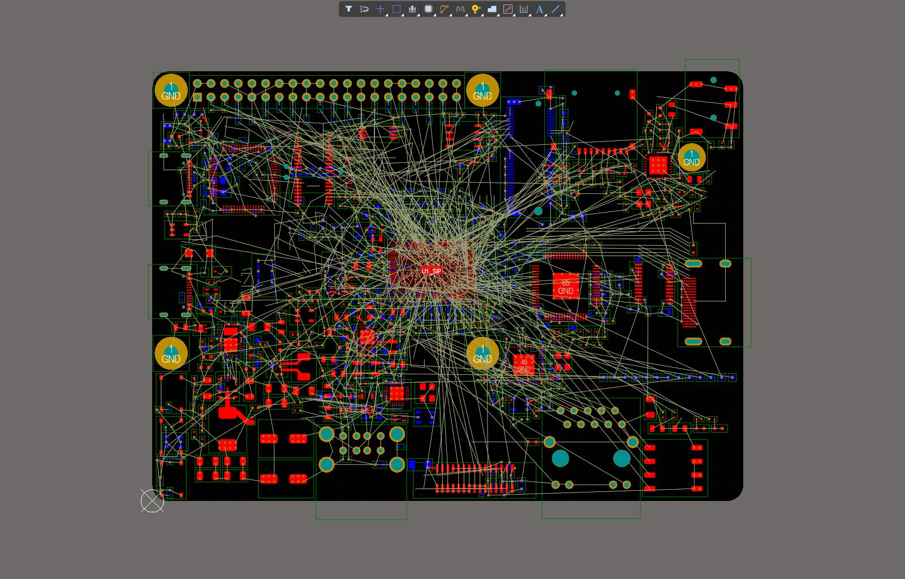
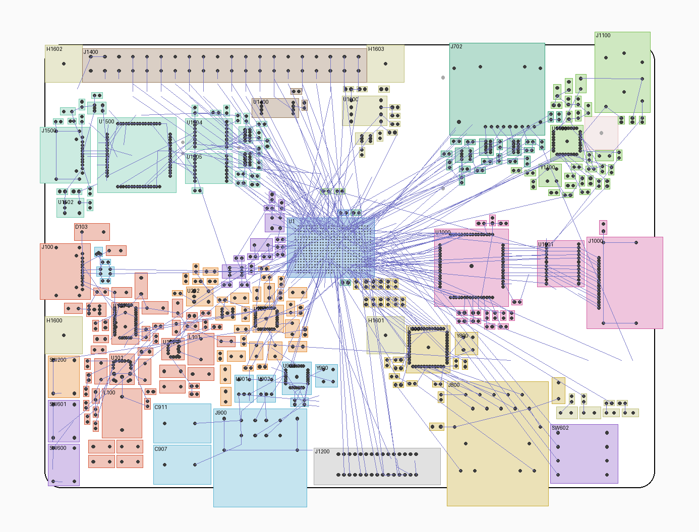
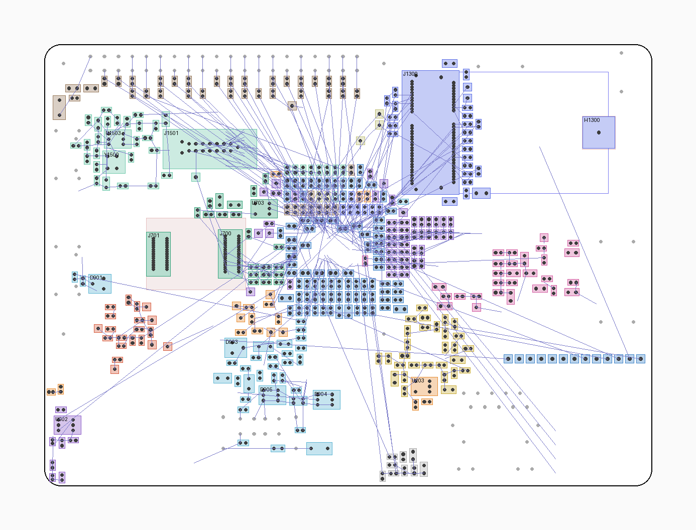
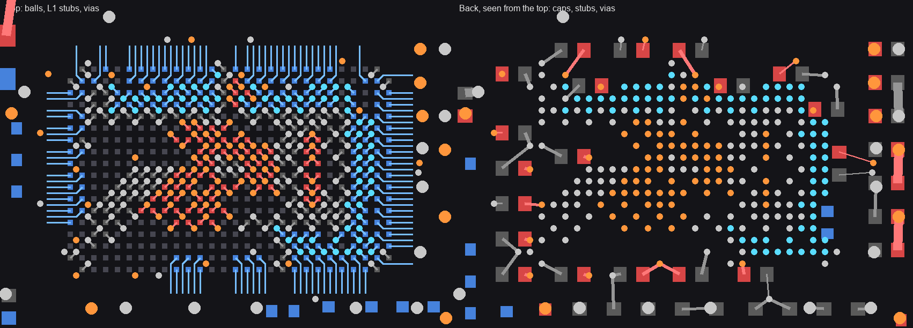
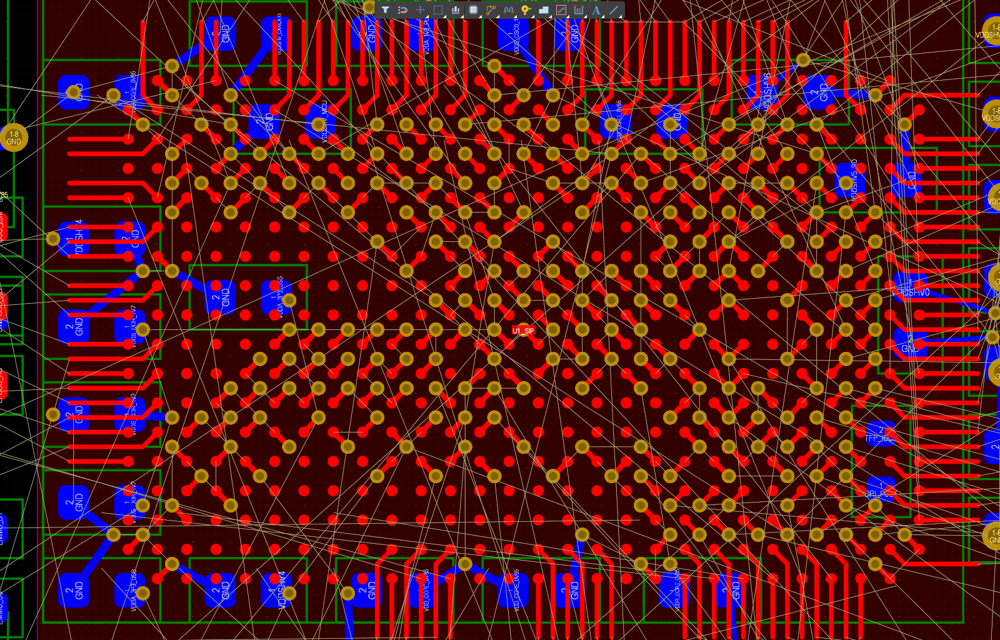

# PCB component placement and fan-out

State of `hardware/PCB.PcbDoc`: 110 x 80 mm outline, 8-layer stack, every part placed (including DNP parts), high-speed rules set, fan-outs done. Signals are not routed, and there are no power pours yet. The rules, their sources and the net lists are in [`hardware/gen/README.md` section 11](../hardware/gen/README.md#high-speed-constraints).

| Top side | Back side (seen from the top) |
|---|---|
|  |  |

*Offline renders from `placement.py`. Courtyards are coloured by schematic sheet, pink areas are keepouts, blue lines are the signal ratsnest. The blue outline on the back is the M.2 card.*

## Board size: 110 x 80 mm

The Raspberry Pi rectangle (85 x 56) is the upper-left part of the board. The board grows 25 mm to the right and 24 mm down, so the holes and the 40-pin header stay where a Pi has them.

| Item | Position on this board (mm from the lower-left corner) | Source |
|---|---|---|
| Corners | R3 | Pi 4 mechanical drawing |
| Mounting holes | (3.5, 27.5), (61.5, 27.5), (3.5, 76.5), (61.5, 76.5): 58 and 49 apart | Pi 4 drawing, HAT mechanical spec |
| 40-pin header centre | (32.5, 76.5), pin 1 at (8.37, 75.23) | Pi 4 drawing: 29 from the hole column, on the upper hole row |
| HAT footprint | x < 65, y > 24 | HAT spec: 65 x 56 |

All courtyards on both sides add up to 6,199 mm². With the far side of through-hole parts, the area under the eMMC module, and the SiP and TFP410 via fields, that is 7,827 mm², or 44 % of both sides. [pcb-floorplan.md](pcb-floorplan.md#why-110-x-80) has the size comparison.

## Floorplan

The SiP sits near the middle of the board at (52, 43). Each block sits on the side of the SiP that its balls face, so the whole board is used and no main bus crosses the board. [pcb-floorplan.md](pcb-floorplan.md) has the plan as first reviewed and what changed from it.

| SiP side | Goes to | Where |
|---|---|---|
| North (rows A-D) | Header, debug, SD, SDIO | Header series parts along its south edge; debug in the north-west; SD socket and audio in the north-east, M.2 card under them |
| East (columns 25-28) | DPI, McASP | TFP410, then `U1001` and `J1000` in a straight line |
| South (rows U-V) | USB1, CSI, RGMII | South edge, west to east: `J900` with the hub above it, `J1200`, `J800` with the PHY above it |
| West (columns 1-2) | MMC0, clocks, USB0 | eMMC module on the back, clocks on top, `J100` on the west edge |
| South-west corner | Power | PMIC at the SiP, 3.3 V buck and 5 V buck-boost further out |

## How positions are set

Every position is in [`hardware/gen/blocks/`](../hardware/gen/blocks), one file per schematic function.

- **Single parts and rows are written by hand** with coordinates: connectors, ICs, power stages, crystal groups, series rows, strap rows, SiP decoupling, header resistors.
- **Other passives are given by hand as a pin and a side.** `blocks.py` only finds the nearest free spot there, 0.50 mm from its neighbours, with the part's pad on that net towards the pin.
- **An overlap in a row is an error to fix in the file.** Nothing is moved to make it fit.
- **Two-pin parts** placed with coordinates may turn 180° so that their pads face what they serve.

### Passives around the SiP

All on the back, grouped by rail.

- **Under the body:** 20 parts in the spots that clear the fan-out vias. They go to the most central balls: `VDD_CORE`, `VDDS_DDR`, `VDDR_CORE`, the small analog rails and the IO banks.
- **South:** one column per analog rail, in ball order: 100 nF nearest, then bulk, then the bead.
- **East:** the IO banks' caps in a column in ball order, their 0R links beside them.
- **North:** four rows. I²C slew parts first (sheet 14 wants them within 5 mm), then the parts the schematic puts at a ball, then bulk and beads.
- **West:** the kept eMMC corridor, with pull-ups just south of it.

## Fan-outs

Scripted by `fanout.py`, with no autorouter. Nothing joins one part to another, except that a pad may share a same-net via beside it, and the switch nodes stay on the surface between their pads.

| What | How | Count |
|---|---|---|
| SiP power and GND balls | One via between four balls, on a checkerboard of sites. Two-ball rails share a via | 176 balls, 170 vias |
| SiP signals, outer row | Straight stub on L1, 1 mm past the ball field | 55 |
| SiP signals, second row | A jog into the gap between two outer balls, then straight out on L1 | 53 |
| SiP signals, further in | One via beside the ball, for L3 or L6. Each ball gets its own site | 72 |
| Caps under the SiP | A stub to a same-rail via beside them, or a new via | 38 pads, 29 new vias |
| Other SMD power and GND pads | Via in large pads; otherwise a short stub to a via or to a same-net via already beside it | 1,087 pads, 992 vias |
| Switch nodes (`LM_SW`, `BB_L1`, `BB_L2`, `PMIC_LX_B1`-`B3`) | Wide tracks on the surface, no via | |

In all: 1,263 vias and 1,458 stubs (666 mm), with every connected ball and every SMD power and GND pad done. SiP vias are 0.15 / 0.25 mm; others are 0.30 / 0.50 mm, or smaller where that didn't fit.

The vias are tented by a rule, `Mask_Via`: a solder-mask expansion of -0.30 mm on `IsVia`. `IsTenting_Top` and `IsTenting_Bottom` don't stick when set by script on AD26.

*Offline render. Blue: signal copper. Red: power. Grey: GND. Round: vias.*

## Before and after

"Before" is the placement before this rework, on 100 x 70 mm. Distances are straight lines from a passive's pad to the nearest IC, connector, crystal or inductor pin on the same net. Bus lengths are Manhattan, ball to pin. Ratsnest and demand count signal nets only, because power nets go on the planes.

| Measure | Before | Now |
|---|---|---|
| Passives within 3 / 5 mm of the pin they serve (592 parts) | 22.5 / 43.2 % | 40.7 / 62.7 % |
| Decoupling within 3 / 5 mm (263 caps) | 19.8 / 36.5 % | 48.7 / 70.7 % |
| SiP decoupling, median / worst | 10.4 / 15.8 mm | 6.1 / 12.4 mm |
| Total meander needed | 84.0 mm | 38.3 mm |
| Routing demand (RUDY), area over 100 % | 424 mm² | 340 mm² |
| Routing demand, area over 70 % | 908 mm² | 804 mm² |
| Routing demand, peak | 2.92 | 2.89 |
| eMMC length; meander | 2.9-7.5 mm; 53.8 mm | 10.4-15.0 mm; 13.3 mm |
| TMDS | 38.1 mm, diagonal | 19.1 mm, straight |
| MDI | 31.2-34.4 mm | 18.4-21.6 mm |
| USB0 | 47.4 mm | 44.4 mm |
| USB1 | 22.0 mm | 22.2 mm |
| `C602` to `Y600` | 7.0 mm | 2.1 mm |
| `R602` to `Y600`; to ball H2 | 5.7; 10.0 mm | 4.5; 3.3 mm |
| `C361` to ball N7 | 9.3 mm | 2.3 mm |
| `R1300`-`R1304` to their balls | 7.7-10.5 mm | 3.4-6.4 mm |

**Worse:**

| Measure | Before | Now | Why |
|---|---|---|---|
| Signal ratsnest | 7,624 mm | 8,575 mm (+12 %) | Connectors on edges, on a larger board. The old placement was annealed for exactly this number |
| Ratsnest crossings | 3,080 | 3,156 (+2 %) | Same |
| Main bus lines crossing, straight lines from ball to pin | 19 | 40 | SD and SDIO cross once as whole bundles (34), and can avoid each other by layer, as `J702` is on top and `J1300` on the back. RGMII TX and RX (4) and USB0 and USB1 (2) remain |
| CSI | 10.4-16.9 mm | 39.2-44.7 mm | Edge connector, limit 254 mm. Lane spread 5.5 mm against 5.8 mm |
| RGMII | 8.2-13.1 mm | 20.2-25.3 mm | Limit 50.8 mm |
| SD | 32.8-40.0 mm | 42.7-49.9 mm | Socket east of the M.2 socket's peg, limit 201 mm |
| SDIO | 10.3-14.3 mm | 33.8-35.8 mm | M.2 in the north-east, limit 201 mm. Meander falls from 6.4 to 1.2 mm |
| DPI | 7.2-21.2 mm | 13.0-24.0 mm | Limit 71.1 mm. Spread falls from 13.9 to 10.9 mm |

These measures don't show that the board routes more easily; only a real route can test that.

## Placement by block

| Block | Measured |
|---|---|
| LM61460 3.3 V | SW to `L100` 3.6 mm. VIN caps on both sides, output caps south of the inductor |
| TPS63070 5 V, beside USB-A | L1 and L2 to `L101` 4.2 mm. Input caps north, output caps south |
| PMIC | LX to inductors 2.8, 3.2, 3.1 mm. Small caps behind the pins they serve |
| 25 MHz oscillator | `U600` to `R600` 2.1 mm, `R600` to ball G1 2.3 mm |
| 32 kHz crystal | XI on the east pin: `Y600` to ball H1 4.9 mm, load caps 2.1 mm from their pins |
| Hub | Straight below the USB1 balls. Chokes one on each side of the board |
| Ethernet | Transmit series row at the SiP, receive series row on the way to the PHY, load caps behind the crystal |
| Audio | 49 mm or more from the nearest switcher part |

The 32 kHz crystal and 25 MHz oscillator have to sit at the SiP, which is also near the PMIC. They are 9.7 and 13.1 mm from the PMIC body, and 12.5 and 15.8 mm from `L200`. This is the closest any sensitive part gets to a switcher, so check it first if clock noise shows up.

### Placement notes from the schematic

| Note | Result |
|---|---|
| Sheet 14: 47 pF + 62 Ω within 5 mm of the SoC balls | Met: all eight I²C slew parts are 2.8-4.8 mm from their balls |
| Sheet 06: 25 MHz oscillator within a few mm of G1 | Met: see above |
| `FB311`, `C361` near ball N7 | Met: 4.7 and 2.3 mm |
| "At SoC" series parts | `R1000` 0.6, `R700` 2.3, `R729` 2.9, `R1321` 4.3, `R1300`-`R1304` 3.4-6.4, `R1620`, `R1621` 4.8, 5.2 mm |
| `R303`-`R310` IO-bank links next to their bank's caps | **Not all met:** 4.8-12.3 mm from a bank pin. They feed planes, so this is a probing convenience |
| `C605` at ball D6, `C609` at ball D17 | **Not close:** 6.6 and 9.1 mm. The rows north of the SiP are full |

### Stubs

Lengths are from a pad to the nearest point on the straight line between the net's other pads.

| Parts | Length, mm |
|---|---|
| `R900`, `R901` USB-C choke bypass | 1.4 |
| DPI boot straps `R628`-`R643` | 0.8-1.4 |
| SD pull-ups `R723`-`R728`, `R732` | 0.7-3.5 |
| SDIO pull-ups `R1305`-`R1310` | 1.6-4.2 |
| eMMC pull-ups `R701`-`R709`, `R712` | 0.6-5.8 |

No datasheet here gives a stub limit, so this is a judgement to make when routing.

## Where routing will be hardest

1. **Around the SiP.** RUDY is over capacity on about 340 mm² around U1. RUDY overstates this right at a BGA edge, but this is where layers will run out first.
2. **L3 and L6 under the SiP.** 271 vias sit under the body, so the 72 inner signals leave between holes.
3. **RGMII ball order.** The ball order doesn't match the PHY's pin order, so RXC and TX need layer swaps between U1 and the PHY.
4. **East of the SiP.** DPI, McASP and SD all leave in about 11 mm between the SiP and the TFP410, and the transmit RGMII lines pass south of it.
5. **HDR balls on the east side.** Rows F-L in columns 25-26 carry 7 header nets that must cross the DPI escape to go north.
6. **USB0 crosses USB1** once at the balls, because USB0's balls are on the far side of USB1's.
7. **MDI1/MDI2 at the RJ45.** The jack's pin order splits MDI1 around MDI2, so one crossing near `J800` is unavoidable.
8. **TMDS at U1001.** The pairs enter over the top end of the package, run under its body on L1 and reach each pad from the inside (TI SLLSE96F Figure 20, p22).
9. **CSI at its via limit.** Two vias per net: one to leave ball row 3, one to come back to L1 at `J1200`. `CSI_CLK` must also cross D0 and D1.

## Checks

| Check | Result |
|---|---|
| Offline (`blocks.py check`) | No overlaps, all pads inside the outline, no parts over through-holes on the far side, nothing over thermal vias or the SiP's via field except the listed spots, no tails under the module or card |
| Fan-out (`fanout.py plan`) | No ball or SMD power or GND pad left without a fan-out |
| Pads against the schematic (`build.py pcb report`) | 717 components, 458 nets, every pad net matches |
| Stack, profiles, classes and rules (`pcbsetup.py verify`) | Match, with 3 xSignals that now list one more pad, see below |
| `check_placement` and `check_orientation` | **Not re-run since the SiP moved.** The batch DRC below covers part spacing. On the previous pass `check_orientation` scored back-side parts wrongly (`R1406`: 94.7 mil scored, 57.3 mil real), so don't apply its back-side suggestions |

### Batch DRC

| Rule | Count | What it is |
|---|---|---|
| **Un-Routed Net** | **1,727** | **Expected: nothing is routed** |
| **Net Antennae** | **616** | **Expected: fan-out stubs end in open space until they are routed** |
| Solder Mask Sliver, 0.10 mm | 61 | **A real footprint issue, not placement:** a 0.07 mm web between 0.4 mm pitch pads on `J700`, `J701` and `J702`, under JLCPCB's 0.10 mm |
| Silk to Solder Mask | 13 | Top-side stubs passing under part outlines on the overlay. Silkscreen isn't cleaned up yet |
| Board Outline Clearance | 12 | On the outlines of connectors that overhang the edge. No copper |
| Width, `W_PWR_HI` | 2 | 0.15 mm stubs at the PMIC's 0.4 mm pitch pins, where 0.20 mm doesn't fit. A waiver |
| Component Clearance, 10 mil | 2 | `J1400` touches `H1602` and `H1603`, forced by the Pi pattern |
| Length | 25 | Altium's readings on unrouted nets: some 0 mm, some counting pull-up branches. MMC0 6, RGMII 8, DPI 5, McASP 4, MMC1 2 |
| Matched Lengths | 52 | The same: DPI 22, MMC0 9, RGMII 10, MMC1 5, MMC2 5, USB1 1 |
| All others | 0 | Includes every clearance, short-circuit, hole-to-hole and via rule, now tested on real vias and stubs |

The full list is in `hardware/Project Outputs for APE - Single Board Computer/Design Rule Check - PCB.html`. `pcbsetup.py drc` clears the markers afterwards, so unrouted connections don't show two ticks.

### xSignals

`SD_D2_PP1`, `SD_D3_PP1` and `DPI_PCLK-TFP_IDCK_PP1` each list one more pad than `pcbsetup.py` expects (`R726`, `R727`, `R1000`). Altium changed these during this work. They should be rebuilt before length-matching those nets.

### Copper not from these scripts

Two very short free tracks remain on L1 at `J702`: `SD_D2` at (79.42, 65.07)-(79.5, 65.15) and `SD_D3` at (80.6, 65.0)-(80.64, 64.96). They are what is left of 17 tracks on the SD nets and `VDDSHV5_SD` that appeared after an earlier placement push. The scripts leave them alone. They are why the two `MMC1` length hits read 0 mm.

## What was not verified

- **Routability.** Nothing beyond the fan-outs is routed; the figures above are estimates.
- **Power planes.** No pours yet. Each via is a promise that its rail or GND will be there on the inner layers. `powerplanes.py` must be re-run on this placement, and its voltage-drop numbers from the last run no longer apply.
- **Vias near the SiP's edge.** 9 cap vias sit off the site lattice, where the lattice had no room. They pass DRC, but they haven't been checked against the inner-layer pours.
- **Negative mask expansion as tenting.** DRC reads it as closed (the via sliver hits went). Check the mask layer in the Gerbers.
- **M.2 standoff position.** Derived from TI's SK-AM62A (socket centre line to standoff hole 30.06 mm), whose socket has the same contact-row spacing. The LOTES drawing doesn't give it. Check it against a real card.
- **Heights under the M.2 card.** Assumed 1.5 mm clearance from the standoff. Parts under it are 0402, 0603 and 0805, using typical package heights rather than the chosen parts' datasheets.
- **eMMC module.** Its position and orientation come from the Radxa export in the footprint notes, not from a physical module.
- **3D fit.** HAT and case clearance is from footprint positions and drawing heights only.
- **Pad numbering.** The assumed numbering in open items B2-B11 is still open. A correction could change a connector's rotation or a bus's order.
- **Constraints on real copper.** Every length, skew and via rule has only been compared with pad-to-pad estimates.
- **Altium's own impedance.** Altium's calculated values for the profiles were never opened or compared with JLCPCB's.
- **eMMC module length.** The 10.66 mm minimum assumes 10 mm of trace in the module, from the research note's 10-15 mm, not a measurement.
- **Altium stability.** Altium crashed once inside `ADVPCB.DLL` when a DRC started. Later DRC runs finished, and the cause is unknown.

## Not done yet

- **Signal routing and power pours.**
- **Silkscreen.** Reference designators are hidden (`NAMEON=FALSE`). Part outlines on the overlay haven't been cleaned up.
- **Fiducials.** 3 global and 2 local at U1; they aren't in the schematic.
- **JLC panel.** J100, J1500, J800, J900, J1000 and J1100 overhang the board edges, so edge rails on those sides won't work.
- **Double-sided assembly.** 434 parts are on the back, so this needs JLC's double-sided SMT option.

## Re-running

Positions are in `hardware/gen/blocks/`. After a change there, or a netlist change: `blocks.py build`, then with Altium open and the lock taken (`mkdir C:/Users/Public/altium_mcp.lock`): `placement.py apply`, `fanout.py apply`, `pcbsetup.py drc`, `build.py pcb report`. `placement.py board` redraws the outline and notes when the board size changes, and `build.py pcb rules` moves the `U1_SiP` room when U1 moves. After a netlist change, run `build.py check` and `build.py pcb import classes` first; a new part is reported as "not placed" until it has a line in a block file.

`fanout.py apply` replaces all free copper on power and GND nets, and free copper on signal nets only within 2 mm of the SiP.

Things to know when driving this from scripts:

- **`place_components` doesn't update the ratsnest.** The file stores connection lines in `Connections6`, and reopening doesn't rebuild them. `placement.py apply` and `refresh` run `PCB:UpdateConnectivity` for this reason.
- **Bottom-side rotation.** Through `place_components`, a bottom part is mirrored in y and then rotated. `placement.py` works in "mirror x, then rotate" and adds 180° on export.
- **`check_placement` on all parts at once** runs far past the bridge's timeout and locks Altium. `placement_check.py` sends batches.
- **The DRC markers.** `PCB:ResetAllErrorMarkers` inside the DRC's own script run fires before the markers exist. `pcbsetup.py drc` runs it separately.
